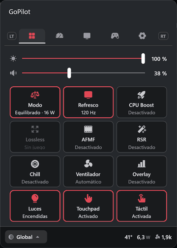
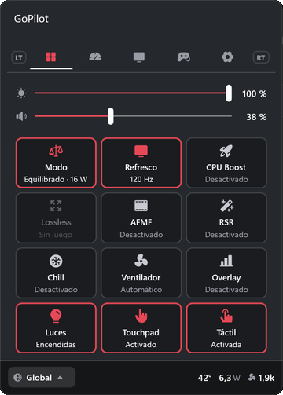
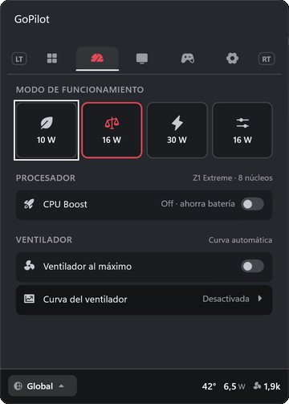
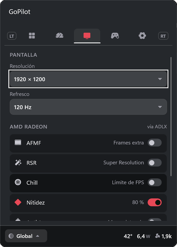
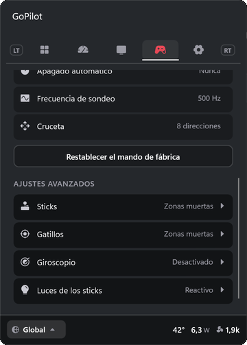
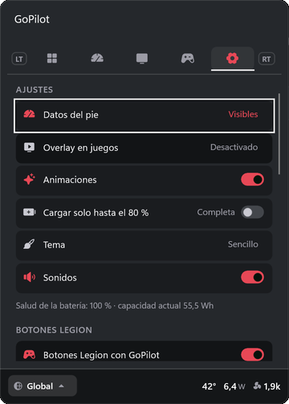

# GoPilot

**El panel de control de la Lenovo Legion Go S, dentro de Xbox Game Bar.**
Rendimiento, pantalla, mando, luces, botones Legion y perfiles por juego en un widget pensado para usarse con el
mando, sin salir del juego. Sustituye a Legion Space: más ligero, más rápido y con más opciones.

[**Descargar la última versión**](https://github.com/dlavia/GoPilot/releases/latest) · Licencia [MIT](LICENSE) · [English](README.en.md)

<p align="center">
  
</p>

**Se siente parte de Windows y de Xbox:**

- Usa el **color de acento de Windows**: cámbialo en Configuración › Personalización › Colores y GoPilot lo sigue.
- **Sonidos de navegación de la app Xbox**, los mismos que suenan en el resto de la consola.
- Ocupa el **sitio del fabricante en Game Bar** (el primer icono) y se abre con **Legion R**, como Legion Space.

> Proyecto personal, no afiliado a Lenovo, AMD ni Microsoft. Probado en una Legion Go S **Z1 Extreme**
> (modelo 83N6, BIOS S0CN27WW) con Windows 11. Úsalo bajo tu responsabilidad: cambia ajustes de la BIOS
> (TDP, ventilador, carga) y del firmware del mando, siempre dentro de los límites que permite el propio firmware.

---

## Índice

- [Instalación](#instalación) · [Actualizar](#actualizar) · [Desinstalar](#desinstalar)
- [Cómo se usa](#cómo-se-usa)
- [Funciones](#funciones): [Inicio](#inicio) · [Potencia](#potencia) · [Pantalla](#pantalla) · [Equipo (mando)](#equipo-mando) · [Ajustes](#ajustes)
- [Perfiles por juego](#perfiles-por-juego) · [Botones Legion](#botones-legion) · [Overlay en los juegos](#overlay-en-los-juegos)
- [Privacidad](#privacidad) · [Preguntas frecuentes](#preguntas-frecuentes) · [Para desarrolladores](#para-desarrolladores)

---

## Instalación

1. Descarga `GoPilot-<versión>.zip` de [Releases](https://github.com/dlavia/GoPilot/releases/latest) y descomprímelo.
2. Doble clic en **`Instalar GoPilot.cmd`** y acepta el aviso de administrador.
   Windows avisa porque el instalador viene de internet: «Windows protegió tu PC» › **Más información** ›
   **Ejecutar de todas formas** (y lo mismo con PowerShell).
3. Pulsa **Legion R**: se abre GoPilot. También está en Game Bar (Win + G) como primer icono de la barra.

Al instalarse, GoPilot **sustituye a Legion Space**: lo desactiva (sin desinstalarlo) y ocupa su sitio en los botones
Legion y en Game Bar. Si lo quieres de vuelta: Ajustes › Botones Legion › Legion Space, o desinstalando GoPilot.

> El paquete va firmado con un certificado propio, que el instalador añade como de confianza. Con **Smart App
> Control** activado Windows no deja instalarlo.

## Actualizar

GoPilot avisa solo cuando hay una versión nueva: un aviso arriba en Inicio y un punto en la pestaña Ajustes.
En **Ajustes › Actualizaciones** se ven las novedades y se instala con **Actualizar** (unos 20 segundos; Game Bar se
cierra un momento y GoPilot vuelve con tus ajustes y perfiles). Solo se instalan paquetes firmados con el mismo
certificado; si algo falla, sigues con la versión que tenías.

## Desinstalar

**Ajustes › Actualizaciones › Desinstalar GoPilot** (pulsar dos veces), o `uninstall.ps1` como administrador.
Deja el equipo como estaba antes de GoPilot: vuelve Legion Space con su icono en Game Bar, se reactivan el touchpad y
la pantalla táctil si estaban desactivados y se quitan el servicio, los datos, las tareas y el certificado.

---

## Cómo se usa

- **Legion R** abre y cierra GoPilot (mantenido: vista de tareas). **Legion L** abre la app Xbox (mantenido: Game Bar).
- **LT / RT** cambian de pestaña: Inicio · Potencia · Pantalla · Equipo · Ajustes.
- **Cruceta** para moverse, **A** para activar, **B** para volver. En los deslizadores se entra con A, se ajusta con
  la cruceta y se sale con A o B (así no se mueven sin querer al bajar).
- **Pie**: abajo, siempre visible, el **perfil aplicado** (A abre la lista para cambiarlo) y los datos en vivo:
  FPS del juego, temperatura, **consumo real en vatios** y velocidad del ventilador.
- Todo funciona también con la pantalla táctil, y con sonidos de navegación como los de la app Xbox.

---

## Funciones

### Inicio



- **Brillo y volumen** siempre a mano.
- **Baldosas de acceso rápido editables** («Editar baldosas»): quitar (X o mantener A), añadir (+) y cambiar de sitio
  (A sobre una y A sobre otra). Por defecto salen 15; hay **35** para elegir:

| Grupo | Baldosas |
|---|---|
| Rendimiento | Modo de energía · CPU Boost · Ventilador al máximo · Curva del ventilador |
| Pantalla | Frecuencia (Hz) · VRR · Lossless Scaling · AFMF · RSR · Chill · Nitidez · Anti-Lag · Vari-Bright |
| Mando | Luces · Giroscopio · Vibración · Vibración del touchpad · Apagado del mando · Sondeo · Cruceta 8/4 |
| Táctil y sistema | Touchpad · Pantalla táctil · Teclado en pantalla · Cerrar juego · Carga al 80 % |
| GoPilot | Overlay · Datos del pie · Tema · Animaciones · Sonidos · Botones Legion · Legion Space · Perfiles automáticos · Autoguardado · Reaplicar tras suspender |

- **Cerrar juego**: cierra el juego en primer plano (pulsar dos veces), útil si se queda colgado.
- **Aviso de actualización** arriba cuando hay versión nueva.

<p align="center">
  
</p>

<br clear="right">

### Potencia



- **Modos de Lenovo** con sus vatios reales, que el firmware cambia según esté enchufada o con batería
  (límite sostenido / ráfagas / picos):

| Modo | Enchufada | Con batería |
|---|---|---|
| Silencio | 10 / 15 / 20 W | 10 / 10 / 20 W |
| Equilibrado | 16 / 25 / 30 W | 15 / 15 / 30 W |
| Rendimiento | 30 / 33 / 40 W | 25 / 25 / 35 W |

- **Manual, como en la Steam Deck**: un solo **límite de potencia** (5–30 W) y debajo el consumo real en ese momento.
  Las ráfagas y los picos se ajustan solos por encima (× 1,25 y × 1,5, hasta 32 y 41 W); en **Avanzado** se pueden
  fijar a mano (SPL, sPPT y fPPT). Se aplica al soltar el deslizador, sin botón.
- **Legion L + Y** cambia de modo (lo hace el firmware) y GoPilot muestra un aviso grande con el modo y sus vatios.
- **CPU Boost**: desactivarlo baja temperatura y consumo con poca diferencia en muchos juegos.
- **Ventilador al máximo** y **curva del ventilador** propia (en modo Manual).
- Al salir de la suspensión se vuelve a aplicar todo (el firmware a veces vuelve a sus valores).

<br clear="right">

### Pantalla



- **Resolución** y **frecuencia de refresco** (hasta 120 Hz).
- **VRR (FreeSync)**: al activarlo también se activa el ajuste de Windows para juegos en ventana o sin bordes.
  Comprobado con PresentMon: la pantalla sigue al juego fotograma a fotograma por debajo de 120 FPS.
- **AMD Radeon** (sin abrir Adrenalin):

| Función | Para qué sirve |
|---|---|
| AFMF | Generación de fotogramas de AMD: más FPS aparentes en casi cualquier juego |
| RSR | Escalado de AMD: jugar a menos resolución y escalar a la pantalla |
| Chill | Limita los FPS entre un mínimo y un máximo para ahorrar batería y calor |
| Nitidez | Realza la imagen (útil con RSR o resoluciones bajas) |
| Anti-Lag | Reduce el retraso entre el mando y la pantalla |
| Vari-Bright | Ajuste automático del brillo de AMD para ahorrar batería |

- **Lossless Scaling**: activar o desactivar su escalado con el juego delante (el estado se lee de su ventana real).

<br clear="right">

### Equipo (mando)



- **Luces de los sticks** (Ajustes avanzados › Luces): 10 colores, brillo y velocidad, con estos efectos:

| Efecto | Qué hace |
|---|---|
| Fijo | Un color constante |
| Respiración | El color se enciende y apaga suavemente |
| Croma | Recorre los colores, los dos sticks a la vez |
| Arcoíris | Recorre los colores en movimiento |
| **Reactivo** | Pulsos de luz con los golpes del sonido del juego (disparos, explosiones), en tiempo real. Brillo en reposo y en el pico ajustables |

- **Vibración** del mando y del touchpad (4 niveles), **apagado automático** del mando, **frecuencia de sondeo**
  (125–1000 Hz) y **cruceta** de 8 o 4 direcciones.
- **Touchpad** y **pantalla táctil**: activar o desactivar.
- **Ajustes avanzados**, cada uno con **Calibrar**, **Probar** (valores en directo) y **Por defecto**:
  - **Sticks**: zona muerta central y de borde de cada stick.
  - **Gatillos**: inicio y fin del recorrido de cada gatillo.
  - **Giroscopio**: como ratón, como stick izquierdo o como stick derecho, con sensibilidad.
- **Restablecer el mando de fábrica**.

<br clear="right">

### Ajustes



- **Datos del pie** (visibles u ocultos), **overlay en los juegos**, **tema** (Sencillo o Contraste, con el color de
  acento de Windows), **animaciones**, **sonidos** y **carga solo hasta el 80 %** (con la salud de la batería).
- **Botones Legion**: qué hace cada pulsación (ver [Botones Legion](#botones-legion)) y el interruptor de Legion Space.
- **Perfiles**: lista de perfiles, aplicarlos automáticamente y guardar cambios automáticamente.
- **Comportamiento**: reaplicar ajustes tras suspender y cada cuánto se actualizan los datos.
- **Actualizaciones**: versión, novedades, buscar automáticamente y desinstalar.

<br clear="right">

---

## Perfiles por juego

- Un perfil **Global** y uno por juego, que se aplican solos al abrir y cerrar el juego.
- **Cada juego nuevo recibe su perfil automáticamente** la primera vez que se abre, con los ajustes de ese momento:
  lo que cambies jugando se queda en ese juego. Si borras un perfil, no se vuelve a crear mientras siga abierto.
- Detecta también los juegos con antitrampas (Call of Duty, por ejemplo).
- Cuenta como juego lo que se ejecuta desde una biblioteca (Steam, Epic, Xbox, GOG, EA…), lo que ocupa toda la
  pantalla o lo que ya tiene perfil; las consolas y los programas de Windows nunca.
- Guardan modo y TDP, CPU Boost, resolución y Hz, Lossless, ajustes de AMD (incluido VRR), luces y giroscopio.
- **Autoguardado**: lo que cambias se guarda solo en el perfil aplicado. Sin autoguardado, se guarda con el disquete.
- Desde el pie se puede aplicar cualquier perfil aunque su juego no esté abierto.

## Botones Legion

Por defecto: **Legion L** → app Xbox (mantenido: Game Bar) y **Legion R** → GoPilot (mantenido: vista de tareas).
Cada pulsación y pulsación larga se puede cambiar, y en **Atajos avanzados** se añaden combinaciones Legion + botón.
Acciones disponibles: GoPilot · Game Bar · Inicio de Xbox · Vista de tareas · Escritorio · Teclado · Recortes ·
Captura · Grabar · Modo térmico · Ctrl+Alt+Supr · Administrador de tareas · Lossless · Overlay · Cerrar juego.
Las combinaciones del propio firmware (Legion L + Y, X, A, B, LB) siguen funcionando.

## Overlay en los juegos

Una ventana propia encima del juego (no depende de fijar widgets en Game Bar) con **FPS**, **FPS y batería** o
**FPS, temperatura y batería**; solo en juegos o siempre, y en la esquina que prefieras.

---

## Privacidad

GoPilot no envía datos personales ni estadísticas de uso. Lo único que hace por internet es comprobar si hay una
versión nueva (descarga un pequeño `latest.json` de este repositorio), y se puede desactivar en Ajustes ›
Actualizaciones › Buscar automáticamente.

## Preguntas frecuentes

**¿Puede dañar la consola?** GoPilot solo pide al firmware de Lenovo valores dentro de los límites que el propio
firmware anuncia (por ejemplo, 5–30 W sostenidos, el máximo de AMD para el Z1 Extreme), igual que Legion Space.

**¿Por qué Windows avisa al instalar?** El paquete está firmado con un certificado propio, no con uno de una entidad
reconocida. Por eso hay que confirmar «Ejecutar de todas formas» y no se puede instalar con Smart App Control.

**¿Funciona en otras consolas?** Está hecho y probado para la Legion Go S. En otros equipos muchas funciones (TDP,
mando, luces, botones) no estarán disponibles.

**¿Qué pasa con mis ajustes de Legion Space?** Siguen ahí: Legion Space solo se desactiva. Al reactivarlo o al
desinstalar GoPilot vuelve tal como estaba.

---

## Para desarrolladores

### Arquitectura

```
Widget de Game Bar (UWP, sandbox)               src/GoSPanel.Widget
      │  AppService «GoSPanel.Bridge»
Agente de la sesión del usuario (.NET 8)        src/GoSPanel.Bridge
      │  pantalla, audio, mando (HID), AMD ADLX, perfiles, botones Legion, overlay, Lossless
      │  tubería con nombre \\.\pipe\GoSPanel (JSON por líneas)
Servicio de Windows (.NET 8, SYSTEM)            src/GoSPanel.Service
         WMI de Lenovo (TDP, modos, ventilador, carga), FPS por ETW, consumo RAPL, táctil, Legion Space,
         actualizaciones y desinstalación
```

- El widget no puede tocar hardware desde el sandbox: todo pasa por el agente y el servicio.
- El agente arranca con la sesión (tarea de inicio del paquete) y el widget se conecta a él.
- El servicio solo expone comandos concretos, nunca llamadas WMI arbitrarias.
- Protocolo: `{"cmd":"tdp.set","args":{"spl":15,"sppt":18,"fppt":20}}` → `{"ok":true,"data":{...}}`.

### Compilar

Requisitos: Visual Studio 2022 con la carga de trabajo UWP, SDK de .NET 8 y Windows SDK 10.0.26100.

```powershell
.\scripts\build.ps1            # servicio + widget (con el agente dentro) en dist\
```

La primera vez crea un certificado de desarrollo en `certs\` (no se sube al repositorio).

### Publicar una versión

```powershell
.\scripts\release.ps1 -Notes "- Novedad 1`n- Novedad 2"
```

Compila, etiqueta y crea la Release con el zip y `latest.json`, que es lo que consultan los widgets instalados.

---

## Créditos

- Protocolo del mando y de la BIOS deducido de: el driver de Linux **hid-lenovo-go-s** (Derek J. Clark),
  **lenovo-wmi** del kernel de Linux, **HHD / Handheld Daemon** y la librería de configuración del mando
  que instala Legion Space (solo se reimplementa el protocolo; no se incluye código de Lenovo).
- **AMD ADLX** para los ajustes de Radeon, **Xbox Game Bar Widget SDK**, **PresentMon** para medir el VRR.
- Iconos **Phosphor Icons**.

## Licencia

[MIT](LICENSE).
